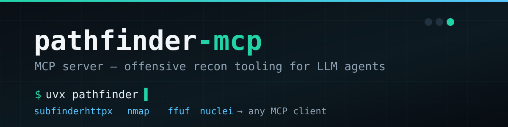
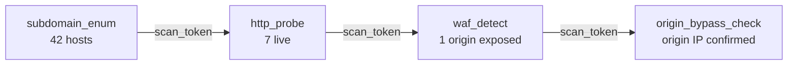

<div align="center">



[](https://www.python.org)
[](https://modelcontextprotocol.io)
[](LICENSE)
[](https://github.com/dewhush/pathfinder-mcp/releases)
[](#development)

**MCP server exposing offensive recon tooling to LLM agents — Claude Code, OpenCode, Codex, Hermes, any MCP client.**


</div>

Pathfinder wraps the recon CLI tools security researchers already use (subfinder, httpx, nmap, ffuf, nuclei) into a single MCP server, so an LLM agent can plan and execute reconnaissance itself — not just tell you which commands to run.

## Roadmap

- [x] **Phase 1** — passive subdomain enum, DNS, WAF detection, tech fingerprint, wayback discovery
- [x] **Phase 2** — active port scan, origin-bypass checks, nuclei templates
- [x] **Phase 3** — session state — the agent chains outputs across tools (`scan_result` tokens) instead of re-parsing raw text
- [ ] **Phase 4** — HTML/JSON report export, target diffing (today vs. yesterday)

## ⚡ Quick start

One command, no clone, no venv (needs [`uv`](https://docs.astral.sh/uv/)):

```bash
uvx --from "git+https://github.com/dewhush/pathfinder-mcp" pathfinder
```

Or the classic way:

```bash
git clone https://github.com/dewhush/pathfinder-mcp.git
cd pathfinder-mcp
python3 -m venv .venv && source .venv/bin/activate
pip install -e .
```

## Requirements

Pathfinder wraps these CLIs. It degrades gracefully — a tool that can't find its binary reports `MISSING_TOOL` rather than crashing. Install the ones you want:

| Tool | Used by | Install |
| ---- | ------- | ------- |
| subfinder | `subdomain_enum` | `go install -v github.com/projectdiscovery/subfinder/v2/cmd/subfinder@latest` |
| httpx | `http_probe`, `tech_detect`, `waf_detect` | `go install -v github.com/projectdiscovery/httpx/cmd/httpx@latest` |
| nmap | `port_scan` | `apt install nmap` |
| ffuf | `endpoint_discover` | `apt install ffuf` or `go install github.com/ffuf/ffuf/v2@latest` |
| nuclei | `nuclei_scan` | `go install -v github.com/projectdiscovery/nuclei/v3/cmd/nuclei@latest` |

No external API keys required. Everything is local or free public APIs (CertSpotter, HackerTarget, AlienVault OTX, urlscan.io, Wayback).

## 🔌 Connect to your agent

<details open>
<summary><b>Claude Code</b></summary>

Local Python:

```bash
claude mcp add pathfinder -- python -m pathfinder.server
```

uvx — no local Python, no clone:

```bash
claude mcp add pathfinder -- uvx --from "git+https://github.com/dewhush/pathfinder-mcp" pathfinder
```

Docker — no local Python needed:

```bash
# pull the release tarball and load it (no registry auth needed)
curl -L -o /tmp/pathfinder.tar.gz \
  https://github.com/dewhush/pathfinder-mcp/releases/download/v0.1.0/pathfinder.tar.gz
gunzip /tmp/pathfinder.tar.gz
docker load -i /tmp/pathfinder.tar
claude mcp add pathfinder -- docker run --rm -i ghcr.io/dewhush/pathfinder-mcp:0.1.0
```

</details>

<details open>
<summary><b>Hermes</b></summary>

```bash
hermes mcp add pathfinder --command "python -m pathfinder.server"
```

</details>

<details>
<summary><b>OpenCode / Codex / other MCP clients</b></summary>

Add to your config:

```json
{
  "mcpServers": {
    "pathfinder": {
      "command": "python",
      "args": ["-m", "pathfinder.server"]
    }
  }
}
```

</details>

**Any MCP client (Docker, manual command):** `docker run --rm -i ghcr.io/dewhush/pathfinder-mcp:0.1.0`

The Docker image bundles subfinder, httpx, nmap, ffuf and nuclei — the full toolset works with zero local installs. Local Python still needs those CLIs on `PATH`; anything missing degrades to `MISSING_TOOL` instead of crashing.

> [!WARNING]
> Pathfinder is a tool-wrapper. **You are responsible** for running it only against infrastructure you own or are authorized to test.

## 🧰 Tools

| | Tool | Wraps | Use |
| --- | ---- | ----- | --- |
| 🔍 | `subdomain_enum` | subfinder + public APIs | passive subdomain enumeration |
| 🌐 | `dns_resolve` | — | A / AAAA / MX / TXT / NS / CNAME |
| 🧭 | `tech_detect` | httpx | web technology fingerprint |
| 🕰 | `wayback_discover` | Wayback | historical URLs |
| 📡 | `http_probe` | httpx | live HTTP(S) services |
| 🎯 | `port_scan` | nmap | top-N ports |
| 🛡 | `waf_detect` | headers + TLS | WAF/CDN identification |
| 🕳 | `origin_bypass_check` | DNS + ranges | WAF origin bypass ([doc](docs/waf-origin-bypass.md)) |
| 🧨 | `endpoint_discover` | ffuf | path fuzzing (`raft-small` default, `seclists` supported) |
| 💉 | `nuclei_scan` | nuclei | template scans |

<details>
<summary><b>Call signatures</b></summary>

```python
subdomain_enum(domain="example.com", source="all")     # or source="otx"
dns_resolve(host="example.com", record_type="A")
tech_detect(url="https://example.com")
wayback_discover(host="example.com", limit=500)

http_probe(hosts=["sub.example.com", "api.example.com"])
port_scan(host="example.com", top_ports=1000)
waf_detect(url="https://example.com")
origin_bypass_check(host="example.com")        # ORIGIN_EXPOSED / WAF_PROTECTED / UNKNOWN
endpoint_discover(url="https://example.com", wordlist="raft-small")
nuclei_scan(target="https://example.com", severity=["high", "critical"])
nuclei_scan(target="https://example.com", templates=["cves", "exposures"])
```

Origin bypass technique: [docs/waf-origin-bypass.md](docs/waf-origin-bypass.md). If a host reports `ORIGIN_EXPOSED`, the origin IP can be reached directly with a spoofed `Host` header:

```bash
curl -H "Host: example.com" https://<origin-ip>/
```

Built-in wordlists: `raft-small` (default), `raft-medium`, `raft-big`, `common`, `seclists` (expects `/usr/share/seclists`). Use `wordlist="/abs/path"` for a custom file.

</details>

## 🔗 Session chaining

Every tool returns structured JSON plus a `scan_token`. Pass it back into any other tool as `from_token` — Pathfinder resolves the token to the relevant hosts/URLs from the current session, so the agent chains steps without you re-typing targets:



Sessions are per-process and in-memory — nothing leaves the machine.

## Development

```bash
pip install -e ".[dev]"
pytest                       # unit tests, no network, all tools mocked
ruff check src tests
ruff format src tests
```

## License

MIT — [0xDew](https://github.com/dewhush). Authorized use only.

<div align="center">
<sub>Built with FastMCP · wrapping projectdiscovery tooling · for authorized use only</sub>
</div>
